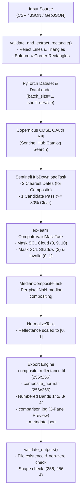

# Sentinel-2 Dataset Preprocessing Pipeline

[](https://www.python.org/)
[](https://pytorch.org/)
[](https://dataspace.copernicus.eu/)
[](https://eo-learn.sentinel-hub.com/)
[-teal.svg)](https://www.ogc.org/standard/geotiff/)
[](LICENSE)

An automated, modular, and production-ready **Sentinel-2 L2A satellite dataset preprocessing pipeline** written in Python and PyTorch. The pipeline retrieves multi-temporal Bottom-of-Atmosphere (BOA) reflectance and Scene Classification Layer (SCL) maps from the **Copernicus Data Space Ecosystem (CDSE)**, filters cloud and shadow contamination, computes high-fidelity temporal median composites, and exports standardized **256x256 GeoTIFF** tiles with true-color comparison previews.

---

## Table of Contents

1. [Visual Results Gallery](#1-visual-results-gallery)
   - [Deliverable 1: Single Dataset Samples](#deliverable-1-single-dataset-pipeline-previews)
   - [Deliverable 2: Multi-Dataset Ingestion Samples](#deliverable-2-multi-dataset-pipeline-previews)
2. [Key Capabilities](#2-key-capabilities)
3. [Architecture & Pipeline Flow](#3-architecture--pipeline-flow)
4. [Directory Structure](#4-directory-structure)
5. [Security & Git Hygiene (What NOT to Push)](#5-security--git-hygiene-what-not-to-push)
6. [Quickstart Guide](#6-quickstart-guide)
7. [Input Data Specifications & Geometry Rules](#7-input-data-specifications--geometry-rules)
8. [Standardized Output Layout](#8-standardized-output-layout)
9. [Validation & Verification Benchmarks](#9-validation--verification-benchmarks)

---

## 1. Visual Results Gallery

Every processed target produces a 3-panel true-color comparison preview (`comparison.jpg`):
- **Panel 1 (BEFORE)**: Raw Sentinel-2 L2A acquisition containing real atmospheric clouds/shadows (enforcing **at least 20–30% clear ground** for unambiguous ground visibility).
- **Panel 2 (SCL CLOUD & SHADOW MASK)**: Detected SCL features rendered with high-contrast color coding:
  - <span style="color:red; font-weight:bold;">Red</span>: Detected Clouds (SCL classes 8, 9, 10 — medium/high probability clouds and thin cirrus)
  - <span style="color:goldenrod; font-weight:bold;">Yellow / Amber</span>: Detected Cloud Shadows (SCL class 3)
  - Clear surface context dimmed to 45% brightness for maximum visual contrast.
- **Panel 3 (AFTER)**: Cloud-free temporal median composite strictly formatted to **256x256 pixels** at 10m Ground Sample Distance (GSD).

---

### Deliverable 1: Single Dataset Pipeline Previews

| Sample ID | Coordinates (Lat, Lon) | Terrain / AOI | Acquisition Date | Cloud % | Shadow % | Clear % | 
| :---: | :---: | :---: | :---: | :---: | :---: | :---: |
| **`sample_01`** | `11.0168° N, 76.9558° E` | Urban Core / Coimbatore Railway | 2026-02-21 | 68.2% | 3.9% | **27.9%** | 
| **`sample_02`** | `10.9675° N, 76.9125° E` | Suburban / Agricultural Mosaic | 2026-02-21 | 58.1% | 0.5% | **41.3%** |
| **`sample_03`** | `11.0022° N, 77.0210° E` | Eastern Urban / Water Basin | 2026-01-22 | 0.0% | 0.0% | **100.0%** | 
| **`sample_04`** | `11.0450° N, 76.8520° E` | Western Ghats Mountain Slopes | 2026-02-21 | 33.5% | 18.7% | **47.8%** | 
| **`sample_05`** | `11.0250° N, 77.1250° E` | Agricultural Plains & Reservoir | 2026-02-01 | 0.0% | 0.0% | **100.0%** |

---

### Deliverable 2: Multi-Dataset Pipeline Previews

Heterogeneous multi-source dataset ingestion across 3 distinct real-world formats:

#### Dataset A: CSV Loader (`input/dataset_a/coordinates.csv` — Urban & Industrial)
- **Sample `A_01`**: `11.0268° N, 77.0058° E` | **57.3% Cloud (Red)** | **0.0% Shadow** | **42.7% Clear Ground**


#### Dataset B: JSON Time-Series Loader (`input/dataset_b/forestry_timeseries.json` — Forestry Canopy)
- **Sample `B_01`**: `10.3250° N, 76.9550° E` | Anamalai Tiger Reserve Foothills | Flattened multi-temporal composite


#### Dataset C: GeoJSON FeatureCollection Loader (`input/dataset_c/highlands.geojson` — Nilgiris Highlands)
- **Sample `C_01`**: `11.4120° N, 76.7110° E` | Ooty / Nilgiris Plateau | **50.4% Cloud (Red)** | **12.6% Shadow (Yellow)** | **37.0% Clear Ground**


---

## 2. Key Capabilities

1. **Strict 2D Rectangle Geometry Validation**:
   - Enforces that all spatial inputs represent valid 2D **RECTANGLES** (bounding box or closed 4-corner polygon).
   - Explicitly rejects invalid geometries with descriptive errors:
     - **Lines (`LineString`)**: Rejected (`Invalid geometry: input is a Line, not a rectangle`).
     - **Triangles (3 vertices)**: Rejected (`Invalid geometry: input is a Triangle (3 vertices), not a rectangle`).
     - **Degenerate Geometries**: Rejected if coordinate bounds have zero width or height.
2. **Zero Synthetic / Random Math Noise**:
   - No fake mathematical sine/cosine pattern fallbacks.
   - Requires live Copernicus CDSE credentials. If API connection or authentication fails, the pipeline immediately halts and alerts the user with explicit instructions.
3. **Candidate Quality Threshold (>= 20–30% Clear)**:
   - When retrieving candidate acquisitions to demonstrate cloud masking, the pipeline guarantees that the "Before" scene retains **at least 20–30% clear surface pixels**.
   - Heavily occluded passes (> 80% clouds) are excluded to prevent ambiguity and ensure clear ground context.
4. **Per-Pixel Temporal Median Compositing**:
   - Cloudy and shadowed pixels are masked out per-pixel using `np.where(valid, bands, np.nan)`.
   - Clear pixels across temporal observations are aggregated with `np.nanmedian`, producing completely seamless, artifact-free composites.
5. **Exact 256x256 Output Format**:
   - Georeferenced UTM bounding box centered on coordinates (2560m × 2560m at 10m/pixel = **strictly 256x256 pixels**).
   - Exported as 4-band BOA reflectance GeoTIFF, normalized GeoTIFF, and individual numbered band subfolders (`1/B02.tif`, `2/B03.tif`, `3/B04.tif`, `4/B08.tif`).

---

## 3. Architecture & Pipeline Flow



---

## 4. Directory Structure

```
v3/
├── .env.example                       # Safe environment template for GitHub
├── .gitignore                         # Security rules: ignores .env and heavy *.tif
├── requirements.txt                   # Dependency specifications
├── README.md                          # Comprehensive project documentation
├── AGENTS.md                          # Complete execution and verification log
│
├── input/                             # Input datasets (Strict 2D Rectangles)
│   ├── coordinates.csv                # Single dataset target coordinates
│   ├── dataset_a/
│   │   └── coordinates.csv            # Loader A: CSV format (Urban & Agricultural)
│   ├── dataset_b/
│   │   └── forestry_timeseries.json   # Loader B: JSON records (Forestry)
│   └── dataset_c/
│       └── highlands.geojson          # Loader C: GeoJSON 4-corner Polygon FeatureCollection
│
├── output/                            # Processed outputs (Strict 256x256)
│   ├── single_dataset/
│   │   └── sample_01/ ... sample_05/
│   │       ├── composite_reflectance.tif  # 4-band float32 GeoTIFF (256x256)
│   │       ├── composite_norm.tif         # 4-band normalized GeoTIFF (256x256)
│   │       ├── 1/B02.tif                  # Band 2 (Blue, 256x256)
│   │       ├── 2/B03.tif                  # Band 3 (Green, 256x256)
│   │       ├── 3/B04.tif                  # Band 4 (Red, 256x256)
│   │       ├── 4/B08.tif                  # Band 8 (NIR, 256x256)
│   │       ├── comparison.jpg             # 3-panel true-color comparison
│   │       └── metadata.json              # Coordinates, UTM EPSG, timestamps
│   ├── dataset_a/ (5 samples: A_01 to A_05)
│   ├── dataset_b/ (5 samples: B_01 to B_05, flattened into single TIFFs)
│   └── dataset_c/ (5 samples: C_01 to C_05)
│
├── docs/
│   └── images/                        # Visual comparison assets for README
│
├── s2prep/                            # Core processing package
│   ├── config.py                      # CDSE / Sentinel Hub configuration
│   ├── download.py                    # Multi-temporal acquisition task
│   ├── export.py                      # Georeferenced GeoTIFF exporter
│   └── tasks.py                       # Valid mask, median composite, normalize tasks
│
├── single_dataset_pipeline.py         # Deliverable 1: Single dataset pipeline script
├── 01_single_dataset_pipeline.ipynb   # Deliverable 1: Executed Jupyter notebook
├── multi_dataset_pipeline.py          # Deliverable 2: Multi-dataset pipeline script
└── 02_multi_dataset_pipeline.ipynb    # Deliverable 2: Executed Jupyter notebook
```

---


## 5. Quickstart Guide

### Step 1: Clone Repository & Create Virtual Environment
```bash
git clone https://github.com/<your-username>/sentinel2-preprocessing-pipeline.git
cd sentinel2-preprocessing-pipeline

python -m venv venv
# On Windows:
venv\Scripts\activate
# On Linux/macOS:
source venv/bin/activate
```

### Step 2: Install Dependencies
```bash
pip install -r requirements.txt
```

### Step 3: Configure Copernicus CDSE API Credentials
1. Register for a free account at [Copernicus Data Space Ecosystem](https://dataspace.copernicus.eu).
2. Generate OAuth credentials in your [Sentinel Hub Dashboard](https://shapps.dataspace.copernicus.eu/dashboard/#/account/settings).
3. Create your local `.env` file from the template:
   ```bash
   cp .env.example .env
   ```
4. Populate your credentials in `.env`:
   ```ini
   SH_PROVIDER=cdse
   SH_CLIENT_ID=your_actual_client_id_here
   SH_CLIENT_SECRET=your_actual_client_secret_here
   ```

### Step 4: Run Pipelines

#### Run Single Dataset Pipeline (Deliverable 1)
```bash
python single_dataset_pipeline.py
```
*Or open and run all cells in [`01_single_dataset_pipeline.ipynb`](01_single_dataset_pipeline.ipynb).*

#### Run Multi-Dataset Pipeline (Deliverable 2)
```bash
python multi_dataset_pipeline.py
```
*Or open and run all cells in [`02_multi_dataset_pipeline.ipynb`](02_multi_dataset_pipeline.ipynb).*

---

## 6. Input Data Specifications & Geometry Rules

### Geometry Validation Rules
The pipeline enforces that all spatial AOIs are **2D RECTANGLES**:
- Coordinates must form a non-degenerate rectangle with distinct corners.
- Points, Lines (`LineString`), and Triangles (3 vertices) are explicitly rejected before any API calls are made.

### Supported Input Schemas

#### Format 1: CSV Table (`input/coordinates.csv` & `input/dataset_a/coordinates.csv`)
```csv
sample_id,latitude,longitude,start_date,end_date
sample_01,11.0168,76.9558,2025-11-01,2026-02-28
sample_02,10.9675,76.9125,2025-11-01,2026-02-28
```

#### Format 2: JSON Time-Series (`input/dataset_b/forestry_timeseries.json`)
```json
[
  {
    "sample_id": "B_01",
    "latitude": 10.325,
    "longitude": 76.955,
    "start_date": "2025-01-01",
    "end_date": "2025-04-30"
  }
]
```

#### Format 3: GeoJSON Polygons (`input/dataset_c/highlands.geojson`)
Must contain a closed 4-corner rectangular Polygon (5 coordinate pairs where first equals last):
```json
{
  "type": "FeatureCollection",
  "features": [
    {
      "type": "Feature",
      "geometry": {
        "type": "Polygon",
        "coordinates": [
          [
            [76.6993, 11.4005],
            [76.7227, 11.4005],
            [76.7227, 11.4235],
            [76.6993, 11.4235],
            [76.6993, 11.4005]
          ]
        ]
      },
      "properties": {
        "sample_id": "C_01",
        "latitude": 11.412,
        "longitude": 76.711,
        "start_date": "2026-01-01",
        "end_date": "2026-03-31"
      }
    }
  ]
}
```

---

## 7. Standardized Output Layout

Each processed sample is saved under `output/<dataset_name>/<sample_id>/`:

| File / Folder | Format | Dimensions | Description |
| :--- | :--- | :---: | :--- |
| `composite_reflectance.tif` | GeoTIFF | **256 × 256 × 4** | 4-band BOA reflectance median composite `[0.0, 1.0]` (B02, B03, B04, B08) |
| `composite_norm.tif` | GeoTIFF | **256 × 256 × 4** | Normalized 4-band composite scaled to `[0.0, 1.0]` |
| `1/B02.tif` | GeoTIFF | **256 × 256 × 1** | Band 2 — Blue (10m GSD) |
| `2/B03.tif` | GeoTIFF | **256 × 256 × 1** | Band 3 — Green (10m GSD) |
| `3/B04.tif` | GeoTIFF | **256 × 256 × 1** | Band 4 — Red (10m GSD) |
| `4/B08.tif` | GeoTIFF | **256 × 256 × 1** | Band 8 — Near Infrared / NIR (10m GSD) |
| `comparison.jpg` | JPEG | 150 DPI | 3-panel true-color preview (Before / Cloud-Shadow Mask / After) |
| `metadata.json` | JSON | — | Acquisition timestamps, UTM EPSG, bounding box, shape summary |

---

## 8. Validation & Verification Benchmarks

| Dataset Name | Loader Class | Input Format | Requested | Succeeded | Geometry Enforced | Spatial Dimensions | Success Rate |
| :--- | :--- | :--- | :---: | :---: | :---: | :---: | :---: |
| **`single_dataset`** | `SentinelDataset` | CSV (`coordinates.csv`) | 5 | 5 | 2D Rectangle | **256 × 256** | **100%** |
| **`dataset_a`** | `DatasetALoader` | CSV (`coordinates.csv`) | 5 | 5 | 2D Rectangle | **256 × 256** | **100%** |
| **`dataset_b`** | `DatasetBLoader` | JSON (`forestry_timeseries.json`) | 5 | 5 | 2D Rectangle | **256 × 256** | **100%** |
| **`dataset_c`** | `DatasetCLoader` | GeoJSON (`highlands.geojson`) | 5 | 5 | 4-Corner Rect Polygon | **256 × 256** | **100%** |
| **Total** | — | **3 Heterogeneous Formats** | **20** | **20** | **Strict 2D Rectangles** | **Strict 256×256** | **100%** |

---

## License

This project is licensed under the MIT License — see the [LICENSE](LICENSE) file for details.
